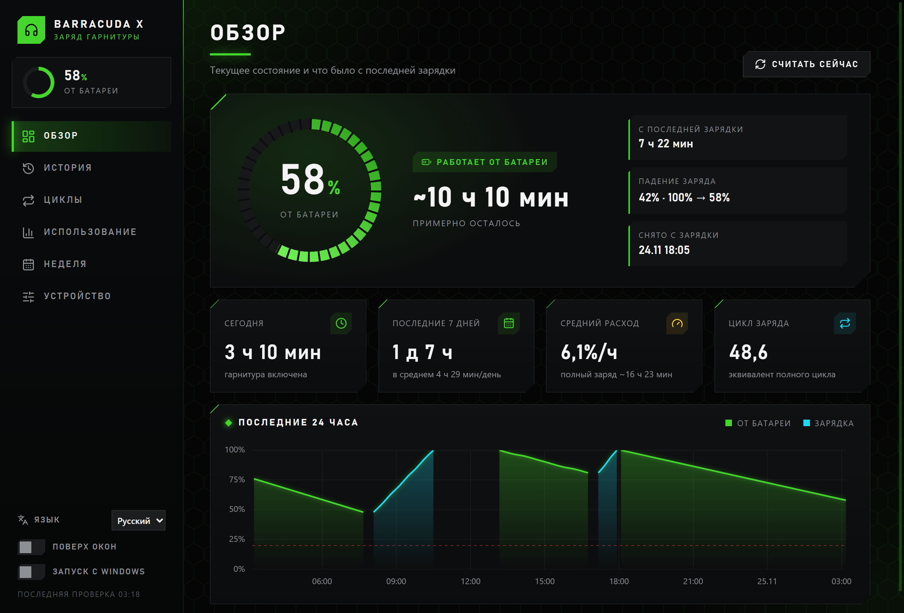
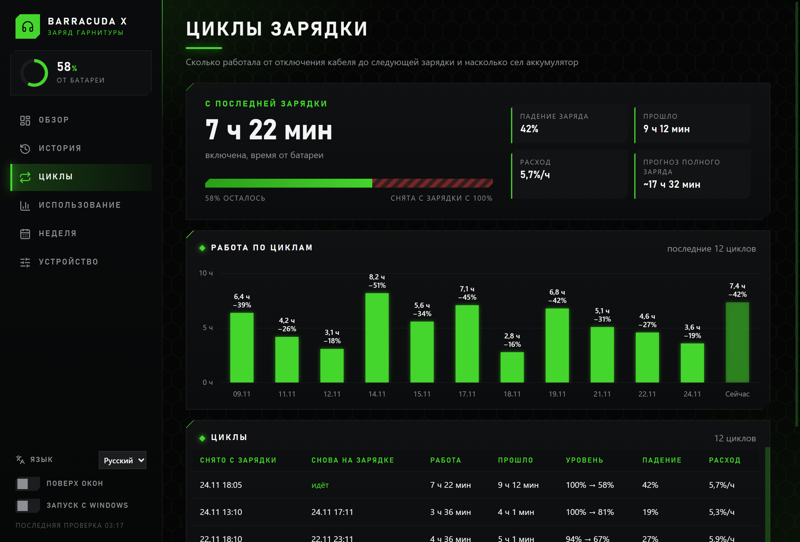
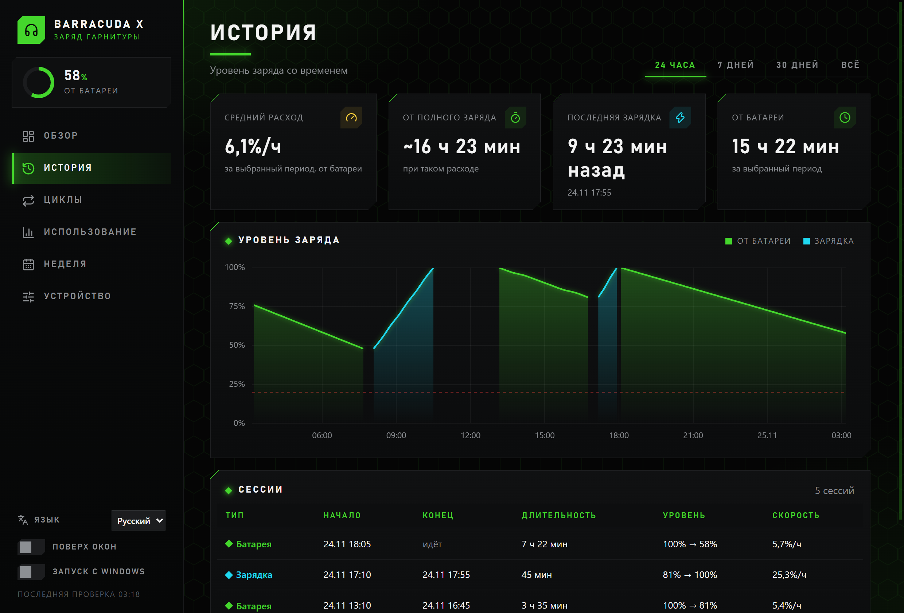
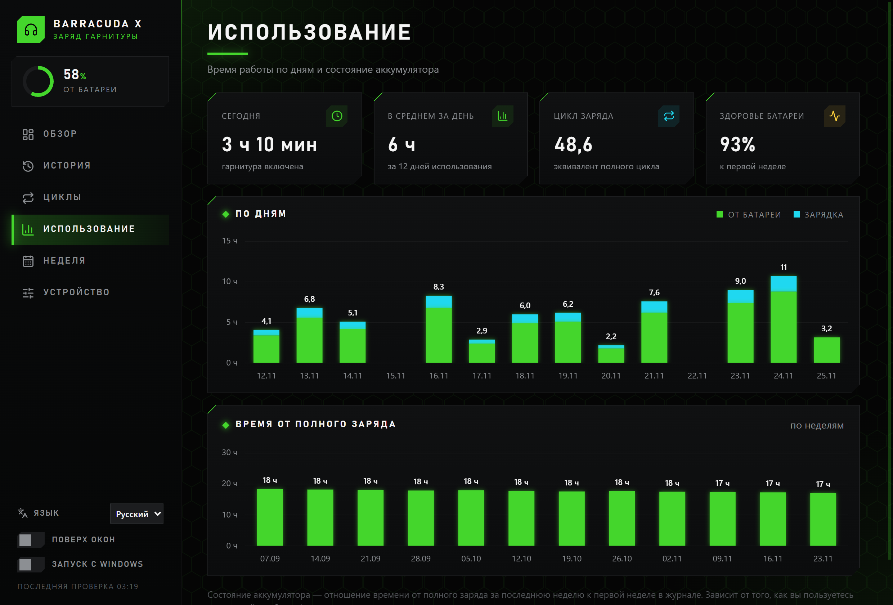
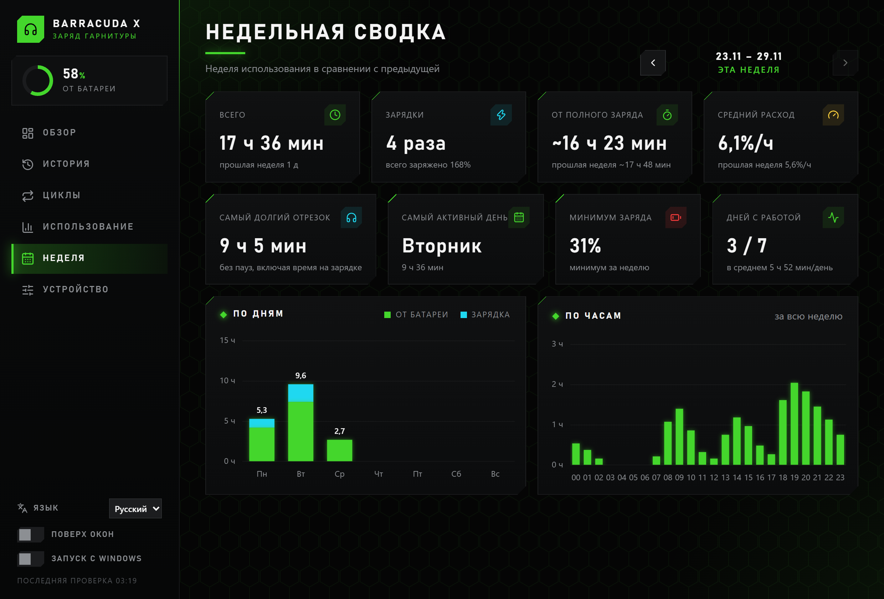
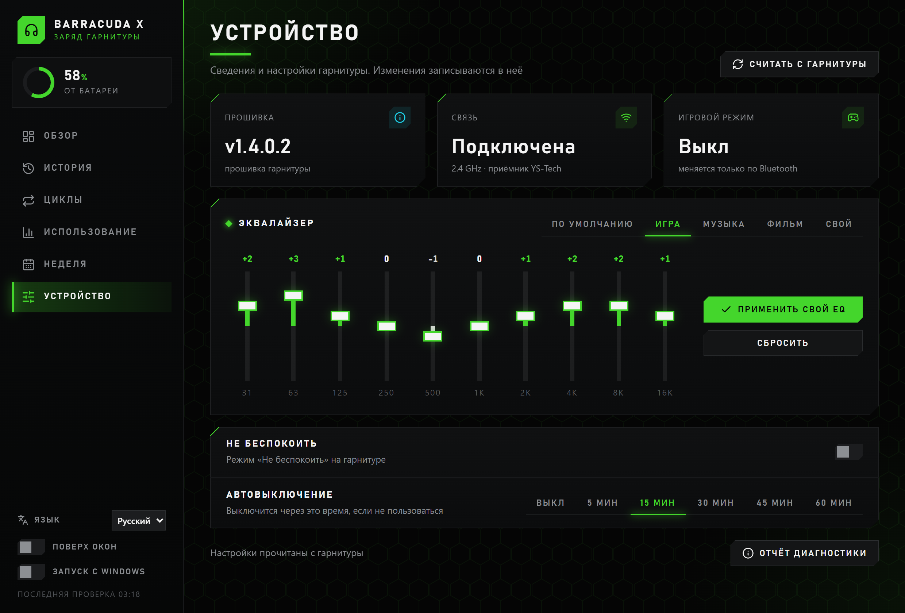

<div align="center">


# Barracuda X Battery

**Уровень заряда, история и настройки гарнитуры Razer Barracuda X (2022) в Windows — через USB-приёмник 2.4 ГГц, где Windows ничего не показывает.**

[](https://github.com/MrVren/barracuda-x-battery-localized-en-ru/releases/latest)
[](#установка)
[](#разработка)
[](#как-это-устроено)
**Русский** · [English](README.en.md)



</div>

---

По Bluetooth Windows показывает заряд Barracuda X. Через приёмник 2.4 ГГц — ничего, а настольная программа Razer эту гарнитуру не поддерживает вовсе: уровень, эквалайзер и таймер автовыключения живут только в телефонном приложении.

Эта программа говорит с приёмником напрямую по HID. Держит уровень в области уведомлений, раз в минуту пишет показание, превращает журнал в историю, циклы зарядки и статистику использования и меняет настройки гарнитуры с компьютера.

## Возможности

| Описание | Превью |
| :--- | :--- |
| **Уровень в области уведомлений.** Иконка в трее — само число процентов; при зарядке оно на цветной плашке. Уведомление о низком заряде на 20 %.<br><br>**Зарядка видна сразу.** Гарнитура сама сообщает о кабеле и изменении заряда; программа слушает эти события и читает уровень за две секунды, не дожидаясь следующего опроса.<br><br>**История.** Уровень за 24 часа, 7 дней, 30 дней или за всё время. Участки на зарядке и от батареи своим цветом, каждая сессия в таблице.<br><br>**Циклы зарядки.** От отключения кабеля до следующего подключения: сколько часов работала, насколько сел аккумулятор и на сколько хватает полного заряда в таком темпе.<br><br>**Использование и недельная сводка.** Часы по дням, недельная цифра «от полного заряда», по которой видно старение батареи, эквивалентные полные циклы и страница недели в сравнении с предыдущей.<br><br>**Настройки гарнитуры.** Пресеты эквалайзера, свой EQ на 10 полос, «не беспокоить» и автовыключение. Каждое изменение читается обратно с гарнитуры, прежде чем считается принятым.<br><br>**Вид в духе Razer.** Чёрный фон, неоновый зелёный, срезанные углы панелей, узкий заглавный шрифт и сегментное кольцо заряда — чтобы стояло рядом с остальным сетапом Razer. |  |

### Экраны

| История | Использование | Недельная сводка |
|---|---|---|
|  |  |  |
| Уровень по времени, сессии, скорость разряда и время от батареи. | Часы по дням, срок от полного заряда за неделю, здоровье батареи. | Одна неделя против предыдущей. |

| Настройки гарнитуры | |
|---|---|
|  | Прошивка, приёмник, пресеты EQ, свой EQ на 10 полос, «не беспокоить» и автовыключение. Каждое изменение читается обратно; то, что гарнитура не приняла, возвращается на экран. |

## Установка

Скачайте `BarracudaBattery-Setup-<version>.exe` со [страницы релизов](https://github.com/MrVren/barracuda-x-battery-localized-en-ru/releases/latest) и запустите.

- Права администратора не нужны. Ставится для текущего пользователя в `%LOCALAPPDATA%\Programs\BarracudaBattery`.
- Python не нужен: среда выполнения внутри установщика.
- Окно рисует Microsoft Edge WebView2; в Windows 11 он уже есть.
- Установщик останавливает уже запущенную копию и может запускать программу вместе с Windows (включено по умолчанию).
- Язык установщика — английский или русский, выбор в начале.
- Установщик 17 МБ, после установки около 41 МБ.

> **SmartScreen.** Установщик не подписан, поэтому Windows предупреждает в первый раз: **Подробнее → Выполнить в любом случае**.

Удаление: Параметры → Приложения. Журнал остаётся в `%LOCALAPPDATA%\BarracudaBattery`; чтобы убрать и его, удалите эту папку.

Интерфейс по умолчанию английский. Русский выбирается внизу боковой панели.

## Поддерживаемое железо

| Приёмник (USB id) | Гарнитура | Статус |
|---|---|---|
| `1532:0550` (мост YS-Tech) | Barracuda X (2022) | Проверено: заряд, кабель, события, все настройки |
| `1532:0552` (мост Macronix) | Barracuda X (2022) | Сделано по опубликованным заметкам о протоколе; на железе ещё не подтверждено |
| `1532:0536`, `1532:0574` | Barracuda X (2021), Barracuda X Chroma | Не поддерживаются; программа называет приёмник и так и пишет |

Barracuda X (2022) бывает с любым из двух приёмников, и оба несут одни и те же команды гарнитуры. По Bluetooth приёмник до гарнитуры не достаёт; там хватает индикатора Windows.

Если у вас `0552` и что-то не работает, откройте **Устройство → Отчёт диагностики** и приложите сохранённый `tanilama.txt` к issue. В нём список HID-интерфейсов, которые видит Windows, и сырой обмен одного чтения.

## Как это устроено

Приёмник мостит USB HID к чипу Airoha в гарнитуре. Каждый разговор переводит приёмник в режим пересылки команд (`E1 01`), шлёт команды customer-data Airoha (`50 41 08 …`) — процент заряда `21`, кабель `2A`, пресет EQ `13`, свой EQ `15`, «не беспокоить» `27`, ожидание `2C` — и переводит обратно. После записи значение читается назад. Две версии приёмника отличаются только HID-рамкой вокруг этих команд:

| | YS-Tech (`0550`) | Macronix (`0552`) |
|---|---|---|
| Report id | `02` | `01` |
| Исходящие | `02 80 len crc crc` + команда, CRC-16/XMODEM | `01 80 len` + команда, после рукопожатия `01 40` |
| Принято | `GetInputReport`: `O` взято, `F` занято | — |
| Входящие | `02 len` + кадры | `01 80 len` + кадры, кадр может занять несколько report |

Программа — два процесса из одного файла:

| Процесс | Что делает | Память |
|---|---|---|
| Трей (`--tray` при входе в систему) | Читает раз в минуту и по событиям гарнитуры, пишет журнал, иконка, уведомления. Без UI-библиотек. | ~33 МБ частных |
| Окно (`--ui`, запускает трей) | HTML-страница в WebView2: читает журнал, читает и пишет настройки. | ~73 МБ + WebView2, только пока открыто |

WebView2 держит около 300 МБ даже со скрытым окном, поэтому закрытие окна завершает процесс, а не прячет его. Именованный мьютекс не даёт двум процессам говорить с приёмником сразу; журнал — SQLite в режиме WAL, пишет трей, читает окно.

```
app.pyw            процесс трея, процесс окна, API страницы
barracuda.py       кадры приёмника, команды гарнитуры, слушатель событий, диагностика
history.py         журнал, сессии, циклы зарядки, дневные и недельные цифры
ui/
  index.html       страницы
  app.css          компоненты и вид в духе Razer
  app.js           данные, графики (Chart.js), анимации, настройки
  i18n.js          английские и русские строки
installer/         скрипт Inno Setup
build.ps1          самопроверки, PyInstaller (одна папка), установщик
```

Данные пользователя, всё в `%LOCALAPPDATA%\BarracudaBattery`:

- `history.db` — строка на каждое показание (время, проценты, зарядка)
- `prefs.json` — «поверх окон» и язык интерфейса
- `tanilama.txt` — отчёт диагностики, когда его создают

## Разработка

```powershell
py -m pip install -r requirements-dev.txt
py app.pyw              # трей, затем окно
py app.pyw --ui         # только окно
py barracuda.py         # одно показание и настройки, в консоль
py barracuda.py --diagnose
```

```powershell
py barracuda.py --selftest   # кадры, сборка кадров, события, проверка значений
py history.py --selftest     # сессии, скорости, циклы зарядки, дневные и недельные разрезы
```

Самопроверкам гарнитура не нужна. Они проигрывают кадры, снятые с приёмника `0550`, и примеры `0552` из заметок leag о протоколе; один из них разрезан на два report.

### Сборка

```powershell
.\build.ps1
```

Запускает самопроверки, собирает программу PyInstaller в `build\app`, затем установщик Inno Setup 6 в `dist\BarracudaBattery-Setup-<version>.exe`. Версия лежит в `installer\BarracudaBattery.iss`.

PyInstaller собирает папку, не один файл: однофайловая сборка каждый раз распаковывается в `%TEMP%`, а процесс окна стартует при каждом открытии.

## Если что-то не так

**«USB receiver is not plugged in»** — нет подключённого поддерживаемого приёмника.

**«This receiver is not supported: …»** — воткнут приёмник Barracuda другой модели; см. таблицу выше.

**«Headset is off, out of range, or in Bluetooth mode»** — приёмник на месте, но гарнитура не отвечает: выключена, далеко или переключена на Bluetooth.

**Игровой режим не меняется.** Гарнитура принимает команду по 2.4 ГГц, но не применяет её: настройка для Bluetooth. Программа показывает её только для чтения.

На русском те же фразы приходят из `ui/i18n.js`.

---

Форк [nightdevx/barracuda-x-battery](https://github.com/nightdevx/barracuda-x-battery).
